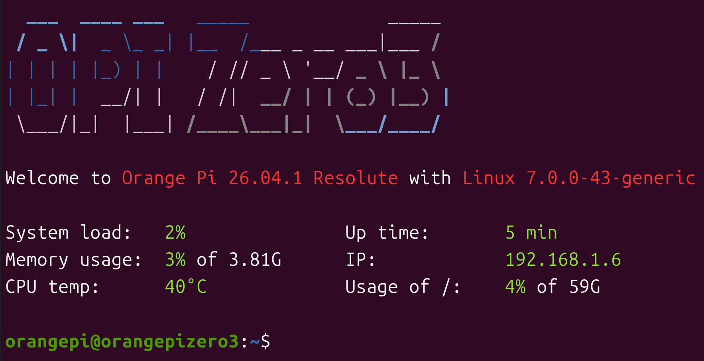

# OrangePi Zero3 Ubuntu

[](https://github.com/CyberXHN/opizero3-ubuntu/actions/workflows/build.yml)

This repository builds a bootable TF-card image for the OrangePi Zero3 (Allwinner H618) from source: a self-built mainline U-Boot + ARM Trusted Firmware boot chain, a GRUB EFI loader, and the stock Ubuntu arm64 kernel. No vendor kernel, no forked bootloader sources. The target use case is a headless server; the author's board is the 4 GB RAM variant, the only hardware this image has been validated on — other memory variants are untested. Kernel upgrades reduce to `apt upgrade && reboot`; end-to-end validation of the full upgrade cycle is still pending. Prebuilt images are attached to [Releases](https://github.com/CyberXHN/opizero3-ubuntu/releases) — download one and skip straight to [Flash](#flash).



## How it boots

The H618 boot ROM loads SPL from raw offset 8 KiB on the TF card. The board has no UEFI firmware; the first-stage loader is read from a raw offset, so the partition table is a plain MBR and the boot chain does not depend on it.

```
BROM → SPL → U-Boot (distro_bootcmd) → BOOTAA64.EFI (GRUB) → kernel + initrd + DTB
```

- U-Boot is built from unmodified mainline sources (tag `v2027.01-rc2`, no patches). Its environment backend is switched to memory-only at build time, so a stray `saveenv` can never touch the onboard SPI flash.
- `BOOTAA64.EFI` is the removable-path GRUB binary from the `grub-efi-arm64` package. A stub config on the ESP locates the ext4 root partition by UUID and hands over to `/boot/grub/grub.cfg`, which loads `vmlinuz`, `initrd.img` and the DTB shipped by the Ubuntu kernel packages.

Card layout (MBR label, 512-byte sectors):

| Region | Offset | Content |
| --- | --- | --- |
| MBR | sector 0 | partition table |
| U-Boot | 8 KiB | `u-boot-sunxi-with-spl.bin` (SPL + U-Boot proper, must stay under 1 MiB) |
| p1 | sector 2048 (1 MiB) | ESP, FAT32, 256 MiB, bootable — `EFI/BOOT/BOOTAA64.EFI` + stub `grub.cfg` |
| p2 | sector 526336 (257 MiB) | ext4 root filesystem, 3840 MiB at build time, grown to fill the card on first boot |

## What works

Verified on real hardware (OrangePi Zero3, 4 GB RAM variant):

- Serial console on the debug header at 115200 8N1.
- Wired Ethernet via DHCP, managed by NetworkManager (`nmcli`/`nmtui`).
- SSH available on first boot (`openssh-server`; root SSH stays at the default `prohibit-password`).
- Official-style login MOTD — logo, `Welcome to Orange Pi` line and system-info panel at every SSH/console login, with the OS release and kernel parsed live from `/etc/os-release`/`uname -r` so `apt upgrade` refreshes the page without a rebuild.
- First-boot root partition auto-grow (oneshot `growpart` + `resize2fs`, then disables itself).
- Per-card identity: SSH host keys and machine-id are regenerated on the first boot.
- Optional first-run network configuration via `orangepi_first_run.txt` (see [First-run configuration](#first-run-configuration) below).
- Green status LED heartbeat, red power LED off — build-time DTB patch plus a runtime service that re-applies it after kernel upgrades, so the fix self-repairs.
- Zram swap (50% of RAM, lzo-rle, priority 5, zswap off — official values), journald capped at 20M.
- Time synchronization via `systemd-timesyncd` (the board has no battery-backed RTC); DNS via `systemd-resolved`, consuming DHCP-provided or first-run static DNS.
- Daily tooling preinstalled: network diagnostics (`ping`, `dig`, `mtr`, `traceroute`, `tcpdump`), editors and file tools (`vim`, `nano`, `less`, `jq`, `rsync`), monitoring (`htop`, `iotop`, `lsof`, `sysstat`), and `curl`, `wget`, `git`, `python3-pip`/`python3-venv`.
- Docker preinstalled but disabled by default — `docker compose` and BuildKit builds work out of the box once `enable_docker.sh` flips the stack on.
- Manual ch.3 hardware features: `/dev/spidev0.0`, IR receiver (`ir-keytable`), hardware watchdog (`/dev/watchdog`), `sensors` over the four H618 thermal zones, 26-pin GPIO via `gpiod`, `i2c-tools`, `v4l2-ctl`, chip ID via the SID nvmem, and pre-generated `en_US.UTF-8` + `zh_CN.UTF-8` locales.
- Kernel headers preinstalled (`linux-headers-generic`), so DKMS and out-of-tree modules build out of the box.

## Known limitations

- On-board WiFi/BT (UWE5622): no mainline driver exists; it does not work with this image.
- No firmware blobs ship in the image (the board needs none): the `linux-image-generic` meta package keeps tracking upstream, but a dpkg `path-exclude` drop-in (`/etc/dpkg/dpkg.cfg.d/01-opizero3-minimal`) stops every `linux-firmware-*` file from unpacking — during the build and on every future `apt upgrade`; only `regulatory.db` is kept. Hardware that does need firmware: remove the drop-in, then `apt install --reinstall linux-firmware-*`.
- HDMI: the mainline `sun50i-h616` dtsi lacks the display pipeline nodes; there is no video output.
- GPU (Mali-G31 / panfrost): not validated.
- 26-pin I2C/PWM buses (and extra UARTs beyond the console): the controllers ship disabled in the mainline DTB and enabling them needs per-bus pin-muxing DT overlays, not implemented yet; only the PMU I2C bus (`/dev/i2c-0`) is present. `wiringOP` targets the vendor kernel and only partially works on mainline — prefer the `gpiod` tools for 26-pin GPIO.
- Journald logs do not survive reboots: `/var/log` lives on a tmpfs mount (see What works); long-lived log history needs an external log shipper.
- Kernel-upgrade cycle (`apt upgrade && reboot`): the image is designed for it, but end-to-end validation is pending.
- Default credentials are `orangepi`/`orangepi` (uid 1000, sudo group) and `root`/`orangepi` (serial rescue only). Change both passwords immediately on first boot.

## User manual alignment

The official OrangePi Zero3 user manual, chapter 3 (Debian/Ubuntu server), is the reference for this image's user-facing features. In short:

- **Works**: serial console, wired Ethernet (`nmcli`/`nmtui`), SSH with the official-style welcome page, on-board LED, first-boot rootfs auto-grow, SPI, IR receiver, hardware watchdog, thermal sensors, 26-pin GPIO (`gpiod`), chip ID (SID nvmem), Python, Docker, kernel headers, zh_CN locale, `rsync`/`scp`.
- **Partial**: 26-pin I2C/PWM and extra UARTs need DT overlays (not implemented); `wiringOP` targets the vendor kernel — prefer `gpiod`.
- **Not supported**: on-board WiFi/BT (UWE5622), HDMI/audio (no mainline display pipeline), boot/shutdown logo, `opi-bkimg` (use `dd`).
- **On demand**: heavier stacks (HomeAssistant, OpenCV, QT, ROS, …) — network plus `git`/`curl`/`build-essential`/`cmake`/`python3-venv` prerequisites are preinstalled.

## Requirements

- amd64 host: Docker, plus qemu binfmt support with the fix-binary (`F`) flag registered so arm64 containers run transparently. On Ubuntu 26.04 and later the packages are `qemu-user` and `qemu-user-binfmt`.
- arm64 host: runs natively, no qemu needed.
- Roughly 10 GB of free disk space for the build tree.
- A TF card of at least 8 GB for flashing.
- Optional: a USB-TTL serial adapter (115200 8N1) for troubleshooting.

## Build

```
git clone --recurse-submodules https://github.com/CyberXHN/opizero3-ubuntu.git
cd opizero3-ubuntu
./docker/run.sh         # cross-compiles TF-A BL31 + U-Boot in a container
./docker/run-card.sh    # builds the card image in an arm64 container
```

- `./docker/run.sh` builds TF-A BL31 (`PLAT=sun50i_h616`) and U-Boot (`orangepi_zero3_defconfig`) out-of-tree inside an amd64 container, then runs smoke assertions (SPL magic, size under 1 MiB, environment-backend config). Artifact: `build/uboot/u-boot-sunxi-with-spl.bin`.
- `./docker/run-card.sh` builds the image inside an arm64 container (qemu-emulated on amd64 hosts) from the official `ubuntu-base` 26.04 rootfs and finishes with a set of post-build assertions covering the boot chain, initrd contents, partition layout and user setup. Artifact: `build/orangepi-zero3-ubuntu-26.04.img`.

Compress and hash for distribution:

```
xz -9e --threads=1 --dict-size=512Mi build/orangepi-zero3-ubuntu-26.04.img
sha256sum build/orangepi-zero3-ubuntu-26.04.img.xz > build/orangepi-zero3-ubuntu-26.04.img.xz.sha256
```

## Flash

Download the latest image and its `.sha256` from [Releases](https://github.com/CyberXHN/opizero3-ubuntu/releases) — assets carry a version tag (`…-v2026.11.15.img.xz`) — or build your own (see [Build](#build)); adjust the file names below accordingly. Verify, then flash:

```
sha256sum -c orangepi-zero3-ubuntu-26.04.img.xz.sha256
xzcat orangepi-zero3-ubuntu-26.04.img.xz | sudo dd of=/dev/sdX bs=4M conv=fsync status=progress
```

Replace `/dev/sdX` with the actual TF card device — double-check it with `lsblk` first; everything on the target device is destroyed.

On first boot the root partition grows to fill the card (then the grow service disables itself), the serial console comes up at 115200 8N1, and SSH is reachable once the board has picked up a DHCP lease.

## First-run configuration

Aligned with the official image's `orangepi-firstrun-config`: put a file named `orangepi_first_run.txt` on the card and the board applies it on the first boot, before the first login. A template ships in both supported locations:

- ESP root (`/boot/efi` when the card is mounted in Linux; FAT32 — editable from Windows): `/boot/efi/orangepi_first_run.txt`
- ext4 root, the official image's path: `/boot/orangepi_first_run.txt`

If both exist the ESP copy wins. Variables follow the official `orangepi_first_run.txt.template` shipped in both places: `FR_net_change_defaults`, `FR_net_ethernet_enabled`, `FR_net_wifi_enabled` (logged and ignored — the onboard UWE5622 has no mainline driver), `FR_net_use_static` with `FR_net_static_ip` / `FR_net_static_mask` / `FR_net_static_gateway` / `FR_net_static_dns` (a dotted netmask is converted to a prefix length), and `FR_general_delete_this_file_after_completion` (default 1: after applying, the file is overwritten with random data and deleted so credentials do not linger; 0 renames it to `.old`).

Semantics carried over from the official implementation:

- The file is CRLF-normalized and syntax-checked (`sh -n`), then sourced as a shell file — only place a config you wrote yourself.
- A `/root/.not_logged_in_yet` sentinel gates the run: once it is consumed (the first boot that applies the config), later-added files are ignored and the board stays under your control.
- A static IP is applied as a NetworkManager keyfile (`/etc/NetworkManager/system-connections/opizero3-firstrun.nmconnection`), which replaces the shipped default DHCP profile; DNS (static `FR_net_static_dns` or DHCP-provided) is consumed by `systemd-resolved`.

The first boot also regenerates the SSH host keys and the machine-id that are identical on every flashed card (official `orangepi-firstrun` alignment): every card ends up with its own identity.

## Configuration

Both wrappers source `docker/local.env` when it exists. The file is git-ignored; create it from the checked-in template:

```
cp docker/local.env.example docker/local.env
```

Every variable is optional; an empty value (or a missing `docker/local.env`) means official/default behavior:

| Variable | Used by | Meaning | Default |
| --- | --- | --- | --- |
| `JOBS` | run.sh | build parallelism | `nproc` |
| `APT_MIRROR_MAIN` | run.sh | apt mirror for the U-Boot/TF-A build container (Ubuntu archive) | empty = official archive |
| `APT_MIRROR_PORTS` | run-card.sh | apt mirror for the card container and the chroot apt phase (ubuntu-ports); falls back to the official sources if the mirror fails | empty = official |
| `DOCKER_DNS` | run-card.sh | extra `--dns` servers for the card container | empty = Docker default |
| `CHROOT_DNS` | build-card.sh | DNS servers for the chroot apt phase (build-time only; the image ships the `systemd-resolved` stub symlink regardless) | empty = container resolver |
| `NTP_SERVERS` | build-card.sh | NTP servers for a `systemd-timesyncd` drop-in | empty = distro default |
| `UB_BIN` | run-card.sh | U-Boot binary baked into the image | `build/uboot/u-boot-sunxi-with-spl.bin` |
| `IMAGE` | run.sh, run-card.sh | container image tag | `opizero3-uboot-builder` / `opizero3-card-builder` |
| `BUILD_UID`/`BUILD_GID` | run.sh, run-card.sh | host user build outputs are chowned back to | set automatically |
| `DEBUG` | run.sh, run-card.sh | `1` enables `set -x` command tracing (timestamped PS4) in both container build scripts | empty = normal verbosity; CI sets `1` |

## CI

The `build` workflow (`.github/workflows/build.yml`) runs on free native arm64 runners (`ubuntu-24.04-arm`) and is triggered manually from the Actions tab. The compressed image plus its `.sha256` goes to exactly one destination: by default a 1-day workflow artifact; with **create_release** checked in the dispatch form, a GitHub Release on the **release_tag** tag instead, with version-tagged asset names (`orangepi-zero3-ubuntu-26.04-v2026.11.15.img.xz`) so files from different releases stay distinguishable. Build logs are teed to `build/*.log` and uploaded as a `build-logs` artifact when a run fails. Every external input is pinned; see [Build reproducibility and version pinning](#build-reproducibility-and-version-pinning).

## Build reproducibility and version pinning

Every external input of the build is pinned so that two runs of the workflow on the same commit produce the same image as closely as upstream allows. No pin moves on its own: upgrading any of them is an explicit edit to the file listed below.

| Input | Pinned to | Where |
| --- | --- | --- |
| `ubuntu-base` rootfs tarball | exact file name (`ubuntu-base-26.04.1-base-arm64.tar.gz`) + SHA256 `5a1906794ced63a71a8119c3f211ef5f0bbe0a243001b4bbd41fdf80c5b219fd` | `.github/workflows/build.yml`, download step |
| U-Boot sources | submodule commit `ecdcf9e365df6249a57cd8cc946e7026804ff4ae` (`v2027.01-rc2`) | submodule pin |
| ARM Trusted Firmware sources | submodule commit `20d0584ebeb0372f0081cbc32e71b2164e8c74e7` (`v2.15.0-1448-g20d0584eb`) | submodule pin |
| Docker base image | `ubuntu@sha256:fe81560990fae86dc4743202b2cb4d3df98d0bcf949173cecef15ce1127ef852` (multi-platform index digest) | `docker/Dockerfile`, `docker/Dockerfile.rootfs` |
| GitHub Actions | full commit SHAs: `actions/checkout@v7.0.1` (`3d3c42e5aac5ba805825da76410c181273ba90b1`), `actions/upload-artifact@v7.0.2` (`cf430e030ddbb5b0abf93d22962f4752f3646cd9`) | `.github/workflows/build.yml` |
| apt packages in the rootfs | `APT_SNAPSHOT=20261113T030400Z` | `.github/workflows/build.yml`, top-level `env` |

`APT_SNAPSHOT` is the pin that covers the actual image content. [snapshot.ubuntu.com](https://snapshot.ubuntu.com) publishes an immutable daily snapshot of the Ubuntu archive, addressed by a UTC timestamp in `YYYYMMDDTHHMMSSZ` form; `docker/build-card.sh` points the chroot's apt at that frozen state, so the kernel and every installed package resolve exactly as they did on that UTC date. Unset — for instance in local runs — the chroot apt runs against the live repositories instead.

Scope and failure mode:

- Chroot apt (the rootfs): fully effective on any host architecture.
- The two build containers: on amd64 hosts the snapshot pins their toolchain too; on arm64 hosts (the CI runner) their base sources point at `ports.ubuntu.com`, which snapshot.ubuntu.com does not serve — a harmless no-op there, the toolchain floats with the digest-pinned base image (low risk).
- The flashed board is untouched: the snapshot apt drop-in is deleted before image assembly, so the board keeps tracking the live repositories.
- `APT_SNAPSHOT` wins over `APT_MIRROR` / `APT_MIRROR_PORTS`; if the snapshot cannot be resolved the build aborts — no silent fallback to live repositories.

Bumping a pin:

- ubuntu-base tarball: new exact file name + SHA256 in the download step of `build.yml`.
- U-Boot / ARM Trusted Firmware: commit the updated submodule pointer.
- Docker base image: resolve the new index digest (e.g. `docker buildx imagetools inspect ubuntu:24.04`) and replace it in both Dockerfiles.
- GitHub Actions: use the full commit SHA of the new release tag.
- `APT_SNAPSHOT`: set a newer `YYYYMMDDTHHMMSSZ` id — the single intended way to move the kernel and the whole package set forward.

## Repository layout

```
.
├── .github/workflows/       CI workflow (manual build, optional release)
├── u-boot/                  submodule, pinned to v2027.01-rc2
├── arm-trusted-firmware/    submodule, pinned to v2.15.0-1448-g20d0584eb
├── docker/
│   ├── Dockerfile           build container for TF-A + U-Boot (cross)
│   ├── Dockerfile.rootfs    arm64 card-build container
│   ├── build-uboot.sh       runs inside the build container
│   ├── build-card.sh        runs inside the card container
│   ├── run.sh               host wrapper: U-Boot build
│   ├── run-card.sh          host wrapper: card image build
│   └── local.env.example    template for docker/local.env
├── downloads/               downloaded inputs (git-ignored): ubuntu-base tarball
├── build/                   build outputs (git-ignored): U-Boot binary, card image
└── README.md
```

## Licenses and redistribution

Released images are a stock-Ubuntu remix: every file comes either from the pinned `ubuntu-base` rootfs, from Ubuntu archive packages installed through the pinned `APT_SNAPSHOT` state, or from this repository's own tooling. Distribution terms:

- Every package keeps its `/usr/share/doc/<pkg>/copyright` file in the image, so the per-package license notices (GPL-2/3, LGPL-2.1+, BSD, MIT, Apache-2.0, and similar free licenses — every preinstalled package comes from `main`/`universe`, none from `restricted`/`multiverse`) travel with the artifact itself.
- The GPL families require a source offer for the exact binaries shipped; the pinned inputs make that offer concrete: the `APT_SNAPSHOT` id on [snapshot.ubuntu.com](https://snapshot.ubuntu.com) preserves the full archive state (binary and source packages) the image was built from, the `ubuntu-base` tarball is pinned by SHA256, and U-Boot / ARM Trusted Firmware / GRUB are built from pinned public commits (U-Boot GPLv2, TF-A BSD-3-Clause, GRUB GPL-3).
- No proprietary firmware ships: the `dpkg` `path-exclude` drop-in keeps `linux-firmware-*` blobs out of the image; the only retained file is `regulatory.db` (redistributable license).
- "Ubuntu" and "Canonical" are trademarks of Canonical Ltd.; "OrangePi" is a trademark of Shenzhen Xunlong Software CO., Limited. This is an unofficial rebuild for the OrangePi Zero3 and is not endorsed by or affiliated with Canonical or Xunlong.

## License

The build scripts and repository tooling are licensed GPL-2.0-only; `LICENSE` carries the full license text and `REUSE.toml` holds the SPDX declarations. Upstream projects keep their own licenses: U-Boot is GPLv2, ARM Trusted Firmware is BSD-3-Clause, and the Ubuntu base rootfs content remains under the copyright of its respective owners.

## Acknowledgments

- The U-Boot project — mainline H618 / sun50i support.
- ARM Trusted Firmware — BL31 for `sun50i_h616`.
- Ubuntu — the `ubuntu-base` rootfs and the arm64 generic kernel.
- orangepi-xunlong — upstream source of `orangepi_zero3_defconfig`.
- Armbian — origin of the official login-MOTD scripts (`10-orangepi-header`/`30-orangepi-sysinfo` carry the Armbian GPL-2.0 copyright header).
